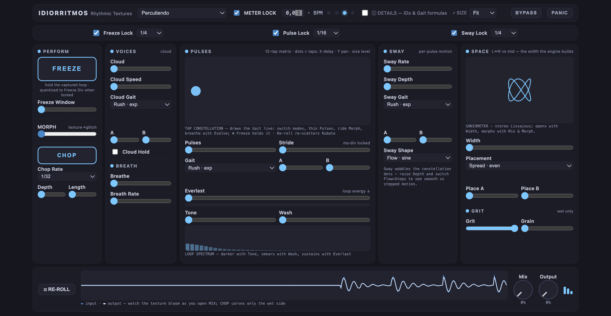

# IDIORRITMOS

**An idiorhythmic texturizer. Everlasting layers of sound, chopped by human rhythm.**

IDIORRITMOS is a stereo texture-processing plugin (AU / VST3), built in Max/MSP `gen~` and exported with RNBO. It takes any input, a pad, a guitar, a voice or a field recording, and turns it into sustained, evolving beds of sound, which can then be carved rhythmically with frozen textures, grid-locked stutters, tempo-synced chops and slow autonomous drift.

  
   The IDIORRITMOS interface, shown without audio running.

> [!NOTE]
> **Version 1, source-only for now.** The engine, the factory presets and the custom interface are complete for version 1. The AU and VST3 builds pass Apple's `auval` check and run in Ableton Live and Logic Pro. There are no prebuilt downloads yet, so using the plugin means building it from source, which needs Max with an RNBO license.

## The idea

The name comes from **idiorhythm**, "one's own rhythm". In footsteps down a hallway, rain on different surfaces, or a room of overlapping conversations, many rhythms sound at once, each keeping its own tempo, none locked to a shared beat, yet together they form a living texture.

IDIORRITMOS works the same way. It scatters the input across many voices and gives each one its own rhythm (its own delay time, its own drift, its own speed), so what returns is a weave of independent pulses rather than a single echo. Those rhythms can float freely in time, or lock onto the host's beat grid together. Moving *with* a groove or *outside* it is the core of the instrument.

The sound vocabulary is rhythmic too: taps are **Pulses**, their spacing is the **Stride**, their distribution is the **Gait**, the per-pulse motion is **Sway**, the texture's own slow drift is the **Breath**, and the rhythmic gate is the **Chop**.

## What it does

- **Everlasting sustain.** Stereo decorrelated feedback with a unity-safe soft limiter: feedback can reach full without runaway, so layers can sustain indefinitely.
- **In-loop diffusion.** A four-stage allpass chain inside the feedback path melts echoes into wash on every pass. An effect placed before or after the plugin cannot reproduce it.
- **True freeze.** A decay-free, color-free hold of the current texture, with a click-free crossfade in and out. Long freeze windows give eternal pads; short ones become rhythmic stutters.
- **Capture cloud.** The live input is replayed by 16 voices at spread speeds, for instant choirs, detuned washes or pitch clusters, with no sample to load.
- **Host-grid lock.** Gate, modulation and freeze can snap to the host's beat grid, with per-domain toggles so some rhythms stay free in milliseconds while others lock to the beat.
- **Performance macros.** Morph (one knob from texture to glitch), the rhythmic Chop with depth and duty, wet-only grit and downsampling, Re-roll for the random tables, and a click-free panic.

47 host-automatable parameters in all. Full reference, including the shared *Gait* distribution engine, is in **[docs/PARAMETERS.md](docs/PARAMETERS.md)**.

## Presets

Ten factory presets in three tiers:

- **Personas**, the four core rhythmic behaviors: *Percutiendo* (drumming), *Bailando* (dancing), *Hablando* (talking), *Patinando* (skating).
- **Scenes**, persona hybrids: *Murmur*, *Stutter Step*, *Pavement*, *Vigil*.
- **Sources**, tuned to a live instrument and built to blend in as Mix is raised: *Harmonic Shadows* for melodic input such as guitar, *Vocal Halo* for voice.

## Building from source

There are no prebuilt downloads yet, so the plugin is built from source on macOS.

The build with the **generic RNBO interface** needs only Max:

1. Install **Max 9.1+** with **RNBO 1.4+** (a license is required to export) and Xcode Command Line Tools (`xcode-select --install`).
2. Open `engine/export_mc_textures_FIXED.maxpat` in Max.
3. Export from the RNBO sidebar: Audio Plugin target, type Effect, formats VST3 + AU, "Include Presets" checked, into the user plugin folders (`~/Library/Audio/Plug-Ins/Components/` for AU, `~/Library/Audio/Plug-Ins/VST3/` for VST3).
4. Rescan plugins in the DAW.

The build with the **custom IDIORRITMOS interface** is a JUCE project on Cycling '74's template; the steps are in [`editor/README.md`](editor/README.md).

## License

The original IDIORRITMOS source (the Max/`gen~` patch and harnesses, the interface code, the factory presets and the documentation) is under the **MIT License**, see [`LICENSE`](LICENSE). It is free to use, fork and build on.

Third-party components keep their own terms, listed in full in [`THIRD-PARTY-NOTICES.txt`](THIRD-PARTY-NOTICES.txt). In short: the RNBO runtime and the code it generates stay under Cycling '74's terms, which permit open-source release and are free for non-commercial use and for commercial use under \$200k annual revenue; JUCE is used under its free Starter license.
