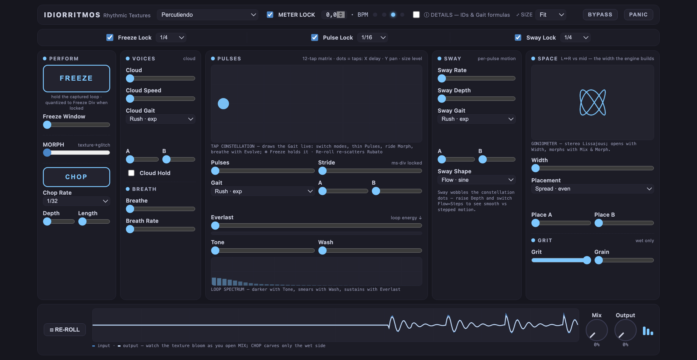

# IDIORRITMOS

**An idiorhythmic texturizer. Everlasting layers of sound, chopped by human rhythm.**

IDIORRITMOS is a stereo texture processor for your DAW (AU / VST3), built in Max/MSP `gen~` and exported with RNBO. It turns any input, whether a synth pad, a guitar, a voice or a field recording, into sustained, evolving beds of sound, and then lets you carve those beds rhythmically: frozen textures, grid-locked stutters, tempo-synced chops, and slow autonomous drift.

  
   The IDIORRITMOS interface, shown without audio running.

> [!NOTE]
> **Version 1, source-only for now.** The engine (v1.3.3), the factory presets and the custom interface are complete for version 1. AU and VST3 builds pass Apple's `auval` check and run in Ableton Live and Logic Pro. There are no prebuilt downloads yet, so using the plugin means building it from source, which needs Max with an RNBO license.

| Start here | What you'll find |
|---|---|
| **[Install](#installing)** → | Build the plugin from source and load it in your DAW |
| **[Presets](#factory-bank)** → | Ten starting points, from rhythmic personas to instrument-ready sources |
| **[Parameters](docs/PARAMETERS.md)** → | All 47 controls: what each one does, its range and default |
| **[Interface](editor/README.md)** → | The custom plugin interface and how to build it |

---

## The concept

IDIORRITMOS is built on a simple idea: **rhythm is more than timing. It reveals behavior, intention, and emotion.** The way someone washes dishes, walks, or speaks carries a rhythmic signature you can hear.

The name comes from **idiorhythm**, *"one's own rhythm."* Pay attention to any everyday scene, such as footsteps in a hallway, rain on different surfaces or a room of overlapping conversations, and you notice many rhythms sounding at once, each keeping its own tempo, none locked to a shared beat, yet together they form a living texture. IDIORRITMOS works that way: it scatters your sound across many voices and gives each one *its own* rhythm (its own delay time, its own slow drift, its own speed), so what returns is a weave of independent pulses rather than a single, grid-locked echo. You can let those rhythms float freely in absolute time, or pull them onto your DAW's beat grid when you want them to lock together. That freedom to move *with* a groove or *outside* of it is the heart of the instrument.

The plugin translates that idea into four **cause-human rhythmic personas**. Each is named as a gerund because it is an *action*, a way of moving through time. They organize its presets and its future interface:

| Persona | Rhythmic behavior | In the plugin |
|---|---|---|
| **Percutiendo** *(drumming)* | Metronomic, grid-aligned, predictable | Tempo-locked gate, quantized freeze, marching tap spacing |
| **Bailando** *(dancing)* | Embodied continuous flow | Voice clouds, smooth sway, slow breathing drift, endless sustain |
| **Hablando** *(talking)* | Irregular, expressive speech phrasing | Rubato tap clusters, stepped sample-and-hold motion, scattered placement |
| **Patinando** *(skating)* | Momentum, then the cut | Long glides, morph toward glitch, short freeze windows, grit |

Even the parameter vocabulary is rhythmic: taps are **Pulses**, their spacing is the **Stride**, their distribution curve is the **Gait** (Rush, March, Divide, Multiply, Even, Rubato…), the per-pulse motion is **Sway**, the texture's own slow drift is its **Breath**, and the rhythmic gate is the **Chop**.

## Use cases

- **Ambient beds from anything:** freeze a single guitar chord or vocal phrase into an infinite pad and play over it.
- **Frozen beds + rhythmic chops:** the signature gesture: hold a wash with Freeze, then carve it with the tempo-locked gate and short freeze stutters, all landing on your DAW's grid.
- **Granular-style clouds from live input:** the capture cloud turns incoming audio into layered multi-speed voices without loading a sample.
- **Textural transitions:** ride the Morph macro from lush texture to sparse glitch for build-ups and breakdowns.
- **Sound design and scoring:** rubato gaits and stepped sway give speech-like, human-irregular movement to static sources.
- **Live performance:** designed around a small set of large gestures (Freeze, Morph, Chop, Re-roll) rather than deep menu editing.

## Features

- **12-pulse distribution-driven delay matrix:** seven Gait curves (exponential, harmonic, subharmonic, even, random-held rubato, and more) shape how echoes distribute in time, reused across taps, modulation rates, cloud voice speeds, and stereo placement.
- **Everlasting sustain:** stereo decorrelated feedback with cross-coupled left/right lines, accurate loop filtering, DC control, and a unity-safe soft limiter: feedback reaches 1.0 without runaway. Layers can genuinely last forever.
- **In-loop diffusion:** a four-stage allpass chain *inside* the feedback path smears echoes progressively into wash on every recirculation. No external effect placed before or after the plugin can replicate it.
- **True static freeze:** decay-free, color-free hold of the current texture, with a click-free crossfade in and out. Long freeze windows give eternal pads; short windows become rhythmic stutters.
- **Capture cloud:** the live input is continuously recorded and replayed by 16 voices at distributed speeds: instant choirs, detuned washes, or pitch clusters from whatever you feed it.
- **Host-grid phase lock:** gate, modulation, and freeze can align to your DAW's beat grid, with launch-quantized freeze commits. Per-domain sync toggles let, say, the pulses float free in milliseconds while the chop stays on the grid.
- **Performance macros:** Morph (one knob from texture to glitch), rhythmic gate with depth and duty, bit-crush and downsampling on the wet path only, re-roll for all random tables, and a click-free panic.
- **Evolve:** two incommensurate slow phases drift the pulse distribution so the texture breathes on its own.
- 47 host-automatable parameters, NaN/Inf-hardened DSP, soft-limited output.

## Factory bank

Ten presets in three tiers:

**Personas:** canonical definitions of each rhythmic behavior: *Percutiendo*, *Bailando*, *Hablando*, *Patinando*.

**Scenes:** persona hybrids: *Murmur* (Bailando × Hablando, a granular murmur of speech-like voices), *Stutter Step* (Percutiendo × Patinando, the signature grid-locked freeze-stutter), *Pavement* (Patinando × Hablando, dark lo-fi grit), *Vigil* (deep Bailando, a near-motionless eternal bed).

**Sources:** plain-named starting points tuned to a live instrument, built to blend as you raise **Mix**. *Harmonic Shadows*, for melodic input such as guitar, surrounds the dry note with a fan of harmonic delay shadows, a pitched cloud halo, and diffusion for a fat, full-width spread. *Vocal Halo*, for voice (spoken or sung), adds a harmonic cloud choir of sub, fifth and octave and a long diffuse wash, scattered across the stereo field.

## Parameters

All 47 controls are host-automatable. The full reference, including the *Gait* distribution engine that several controls share, is in **[docs/PARAMETERS.md](docs/PARAMETERS.md)**.

## Installing

There are no prebuilt downloads yet, so the plugin is built from source on macOS. There are two builds. The **plugin with the generic RNBO interface** needs only Max:

1. Requirements: **Max 9.1+** with **RNBO 1.4+** (a license is required to export) and Xcode Command Line Tools (`xcode-select --install`).
2. Open `engine/export_mc_textures_FIXED.maxpat` in Max. The `gen~` inside the `rnbo~` loads `texture_gen_stereo.gendsp` from the same folder.
3. Optionally click each factory-bank row and capture named RNBO snapshots (the preset rows and capture instructions are embedded in the patch).
4. Export via the RNBO sidebar: Audio Plugin target, type Effect, formats VST3 + AU, "Include Presets" checked, output to your user plugin folders:
   - AU: `~/Library/Audio/Plug-Ins/Components/`
   - VST3: `~/Library/Audio/Plug-Ins/VST3/`
5. Rescan plugins in your DAW (Live: Preferences → Plug-Ins; Logic: restarts scan automatically).

The **plugin with the custom IDIORRITMOS interface** is a JUCE build on Cycling '74's template; the steps are in [`editor/README.md`](editor/README.md).

## Repository contents

| Path | What it is |
|---|---|
| `engine/texture_gen_stereo.gendsp` | **The engine** (v1.3.3): all DSP in one GenExpr codebox |
| `engine/export_mc_textures_FIXED.maxpat` | RNBO export patch with the factory bank wired in |
| `engine/test_gen_stereo.maxpat` | Performance test harness: all 47 params, scene and persona banks, source selector |
| `engine/playback_gen.gendsp` | 16-voice buffer player, for the future MIDI Instrument build |
| `editor/` | The custom plugin interface (JUCE + web UI) |
| `docs/PARAMETERS.md` | Reference for all 47 parameters |
| `docs/design/` | Interactive HTML specs: signal-flow diagram, interface mockup, visualization reference. Download and open in a browser; GitHub shows HTML as source. |
| `legacy/` | Earlier work kept for reference: the original Max-only instrument and the RNBO feasibility spike |
| `CHANGELOG.md` | What changed in each engine version, and why |

## Roadmap

- **Prebuilt downloads**: signed and notarized macOS builds, so the plugin can be installed without Max.
- **MIDI Instrument build**: the same engine as a playable sampler (note-driven capture playback).
- **Interface**: preset panel, visual polish, and a tap constellation driven by real per-tap levels (see `docs/design/gui_mockup_tier2.html`).
- **Archetype phases**: personas as presets today; blendable persona "presence" macros next; generative per-persona rhythm engines after that.

## Lineage and credits

- Built on the sonic character of the original **`mc` multichannel objects** experiments in Max/MSP, the "everlasting layers of sound" that give the texturizer its name.
- The **capture cloud** traces to an earlier `mc` patch of the author's, *Haiku*, which played one recording back at many speeds at once.
- Exported with **RNBO** by Cycling '74.

## License

The **MIT License** (see [`LICENSE`](LICENSE)) covers the original source of IDIORRITMOS, meaning the Max/`gen~` patch and harnesses, the interface code written for this project, factory presets, mockups, and documentation. Use it, fork it, build on it.

Third-party components keep their own terms. The RNBO parts are generated into the build folder by the export and are not stored in this repository; their notices are retained in-file:

- **RNBO engine / runtime** (`export/rnbo/`) — © Cycling '74, **MIT**.
- **RNBO-generated code** (`export/rnbo_source.cpp`, produced from the patch) — © Cycling '74, **dual-licensed** under the *Cycling '74 License for Max-Generated Code for Export* or **GPLv3**. Free for non-commercial, educational, and creative use; commercial distribution is granted free of charge to entities under \$200k annual revenue/funding (above that, contact Cycling '74). Open-source distribution like this one is expressly permitted.
- **Interface template** (`editor/`): these files are modified copies of files from Cycling '74's `rnbo.example.juce` template, © Cycling '74 under **MIT** (notice in [`editor/LICENSE-rnbo.example.juce`](editor/LICENSE-rnbo.example.juce)).
- **JUCE 8** (linked by the plugin build): dual-licensed **AGPLv3** or the JUCE 8 license agreement. IDIORRITMOS is built under JUCE's free **Starter** license, which is why the RNBO-generated code uses Cycling '74's license rather than its GPLv3 option.

In short: the plugin's own code is MIT and free to reuse; the RNBO runtime and generated code stay under Cycling '74's terms, which allow open-source release; JUCE is used under its free Starter license.
